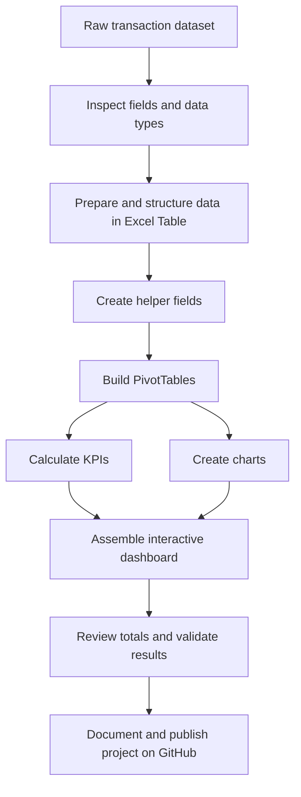

# Coffee Shop Sales Analysis

An end-to-end **Excel-based Data Analytics project** that explores
coffee shop transaction data and presents business-focused insights
through an interactive dashboard.

> **Project type:** Data Analytics \| **Tool:** Microsoft Excel \|
> **Dataset period:** January--June 2023 (as represented in the
> workbook)\
> **Primary goal:** Understand sales performance, customer transaction
> patterns, product/category contribution, store performance, and
> hourly/weekday demand.

------------------------------------------------------------------------

## Dashboard Preview


> Add your dashboard screenshot to the repository at
> `images/coffee-shop-dashboard.png`. You can also change the image path
> above to match your filename.

------------------------------------------------------------------------

## 1. Project Overview

Coffee shops generate transaction-level data every day. This project
turns that raw data into a dashboard that helps answer questions such
as:

-   How much sales revenue was recorded?
-   How many transactions were processed?
-   How do sales and order quantities vary by hour and weekday?
-   Which product categories and products contribute most to sales?
-   How do the three store locations compare?
-   What is the order distribution across drink sizes?
-   Which months show higher sales activity?

The workbook uses Excel data preparation, helper columns, PivotTables,
charts, KPI calculations, and slicers to make the analysis interactive.

## 2. Business Problem

A coffee shop manager needs a quick way to monitor revenue, demand
patterns, product mix, and store-level activity. Reviewing thousands of
individual transactions manually is time-consuming.

**Analytical objective:** summarize transaction data into clear metrics
and visualizations so a manager can explore performance by date,
weekday, month, hour, product category, product, size, and store
location.

## 3. Dataset

The workbook contains **149,116 transaction records** and the following
fields (including analysis/helper fields):

  Field                              Meaning
  ---------------------------------- ---------------------------------------------
  `transaction_id`                   Unique transaction identifier
  `transaction_date`                 Date of transaction
  `transaction_time`                 Time of transaction
  `store_id`                         Store identifier
  `store_location`                   Store name/location
  `product_id`                       Product identifier
  `transaction_qty`                  Quantity ordered in the transaction
  `unit_price`                       Price per unit
  `product_category`                 Broad product category
  `product_type`                     Product/type name
  `product_detail`                   Product detail or variant
  `Custom`                           Size/variant field used in the workbook
  `Total_Bill`                       Transaction sales amount
  `Month Name`                       Month label derived from transaction date
  `Day Name`                         Weekday label derived from transaction date
  `Hour`                             Hour extracted from transaction time
  `Day of Week`                      Numeric weekday helper
  `Month`                            Numeric month helper
  `transaction_date (Month Index)`   Month sorting/index helper
  `transaction_date (Month)`         Short month label

**Data note:** The dashboard's "Footfall" metric is calculated from
transaction count in the workbook. It should therefore be interpreted as
transaction volume, not a verified count of distinct people/visitors.

## 4. Tools & Excel Features

-   Microsoft Excel
-   Excel Tables for structured transaction data
-   Calculated/helper columns for date and time analysis
-   PivotTables for aggregation and comparison
-   PivotCharts / Excel charts
-   KPI calculations
-   Slicers for interactive filtering
-   Number formatting, chart titles, labels, and dashboard layout

## 5. Project Workflow



### Step 1 --- Data inspection

Reviewed the transaction fields, date/time columns, product attributes,
store locations, quantities, and unit prices to understand what each
record represents.

### Step 2 --- Data preparation

Structured the transaction data in an Excel Table (`Transactions`) and
used supporting fields for time-based analysis. Before publishing, check
for blank values, duplicate transaction IDs, inconsistent labels, and
unexpected numeric/date types.

### Step 3 --- Feature engineering / helper columns

Created or used derived fields to make analysis easier: - **Month Name /
Month:** group transactions by month. - **Day Name / Day of Week:**
compare weekday patterns. - **Hour:** analyze demand by hour of day. -
**Month Index:** support chronological month sorting instead of
alphabetical sorting.

### Step 4 --- PivotTable analysis

Created PivotTables to aggregate sales, quantity, and transaction counts
by relevant dimensions such as weekday, month, hour, category, product,
size, and store location.

### Step 5 --- KPI calculations

Summarized the main business metrics and placed them in KPI cards at the
top of the dashboard.

### Step 6 --- Dashboard design

Combined KPI cards, a line chart, bar charts, pie charts, and slicers
into a single dashboard view. Slicers allow users to filter the analysis
by weekday and month.

### Step 7 --- Validation

Compared PivotTable grand totals with KPI totals and checked that chart
values respond consistently to the available filters.

## 6. Dashboard Walkthrough

### KPI Cards

  ------------------------------------------------------------------------
  KPI                                Workbook result Interpretation
  --------------------- ---------------------------- ---------------------
  Total Sales                       **\$698,812.33** Sum of transaction
                                                     bill amounts

  Total Footfall                         **149,116** Transaction count
                                                     used as the
                                                     workbook's footfall
                                                     proxy

  Average Bill / Person                   **\$4.69** Total Sales ÷
                                                     transaction count

  Average Order /                           **1.44** Total quantity
  Person                                             ordered ÷ transaction
                                                     count
  ------------------------------------------------------------------------

**Metric definitions**

-   `Total Sales = SUM(Total_Bill)`
-   `Transaction Count = COUNT(transaction_id)`
-   `Average Bill / Transaction = Total Sales / Transaction Count`
-   `Average Quantity / Transaction = SUM(transaction_qty) / Transaction Count`

The labels "per person" are retained from the dashboard design, but the
available transaction data does not establish unique customer
identities. For precise reporting, "per transaction" is the safer
interpretation.

### 1. Quantity Ordered Based on Hours

A line chart showing total quantity ordered for each hour. It helps
identify busy periods and quieter hours for staffing and operational
planning.

### 2. Category Distribution Based on Sales

A pie chart showing each product category's share of total sales. It
helps compare category contribution and product mix.

### 3. Orders on Weekdays

A horizontal bar chart comparing transaction counts across weekdays. It
helps identify differences in weekday demand.

### 4. Footfall over Store Locations

A column chart comparing transaction counts for: - Astoria - Hell's
Kitchen - Lower Manhattan

This is a transaction-volume comparison, not a unique-visitor count.

### 5. Size Distribution Based on Orders

A pie chart showing the transaction/order distribution across size
labels: - Large - Not Defined - Regular - Small

"Not Defined" is retained as a category rather than silently removed.

### 6. Top 5 Products Based on Sales

A column chart comparing the five displayed product types by sales
amount. The workbook's displayed leaders include Barista Espresso,
Brewed Chai tea, Hot chocolate, Gourmet brewed coffee, and Brewed Black
tea.

### Slicers

-   **Day Name:** filter dashboard analysis by weekday.
-   **Month:** filter dashboard analysis by month.

Slicers are connected to the relevant PivotTables/charts in the
workbook. Depending on Excel connections, a slicer may control only the
PivotTables to which it is connected.

## 7. Key Observations

Based on the workbook's summarized values:

-   Total recorded sales are **\$698,812.33** across **149,116
    transactions**.
-   The highest sales month among the months shown is **June**
    (\$166,485.88), followed by May (\$156,727.76).
-   **Coffee** is the largest category by sales in the category summary
    (\$269,952.45), followed by Tea (\$196,405.95).
-   **Hell's Kitchen** has the highest transaction count among the three
    listed stores (50,735), narrowly ahead of Astoria (50,599).
-   **Barista Espresso** is the highest-sales item among the five
    products displayed (\$91,406.20).
-   Hourly quantity is strongest in the morning-to-midday range in the
    chart, with the highest plotted hour at 10:00.

These are descriptive findings from this workbook, not causal
explanations. Operational decisions should consider staffing, inventory,
promotions, and additional context.

## 8. Repository Structure

Suggested GitHub structure:

``` text
coffee-shop-sales-analysis/
│
├── README.md
├── data/
│   └── README.md
├── images/
│   └── coffee-shop-dashboard.png
├── workbook/
│   └── Coffee_Shop_Sales_Analysis.xlsx
└── LICENSE
```

If the dataset is large or has redistribution restrictions, do not
upload the raw data. Instead, include a data-source note in
`data/README.md` and explain how to obtain it. Keep the Excel workbook
and dashboard screenshot in the repository if you have permission to
share them.

## 9. How to Explore

1.  Download or clone this repository.
2.  Open the Excel workbook in Microsoft Excel (desktop Excel is
    recommended for full PivotTable/slicer functionality).
3.  Open the `Dashboard` sheet.
4.  Use the **Day Name** and **Month** slicers to filter the dashboard.
5.  Review the KPI cards and charts together to understand changes in
    sales, volume, category mix, and store activity.

## 10. Skills Demonstrated

-   Spreadsheet data analysis
-   Data structuring and preparation
-   Date/time feature creation
-   PivotTable aggregation
-   KPI definition and calculation
-   Data visualization and dashboard design
-   Interactive filtering with slicers
-   Business question framing
-   Communicating insights from data

## 11. Limitations & Future Improvements

-   The workbook does not identify distinct customers, so transaction
    count is not the same as unique customer footfall.
-   Add a data dictionary and a documented data-cleaning log.
-   Add a unique-customer field if customer-level analysis is required
    and the source data supports it.
-   Add targets, profit/cost data, and month-over-month comparisons if
    those fields become available.
-   Rebuild the dashboard in Power BI as a follow-up project, with a
    documented data model and measures.
-   Add automated refresh and validation checks for repeatable
    reporting.

## 12. Author

**Rushikesh**\
Aspiring Data Analyst \| Data Science & Analytics Learner

This is a portfolio learning project built to practice Excel-based data
analysis and dashboard reporting.

------------------------------------------------------------------------

*If you found this project useful, feel free to star the repository or
connect with me on LinkedIn.*
